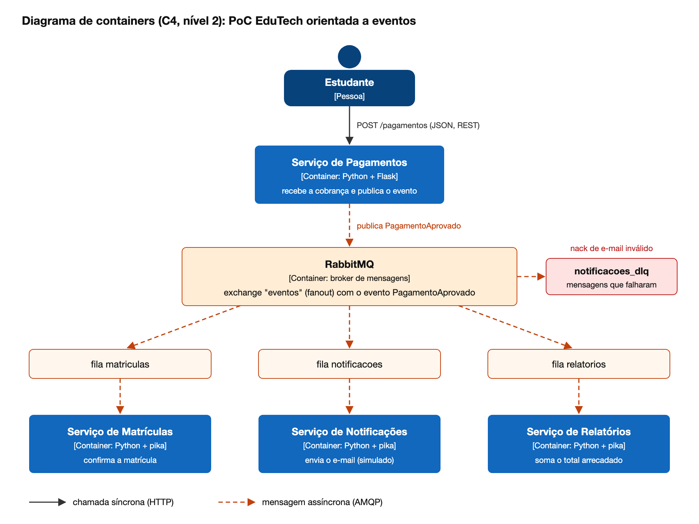

# EduTech: PoC de Arquitetura Orientada a Eventos

Trabalho final da disciplina de Arquitetura de Software (UEPA, Engenharia de Software), Grupo 2, tema Arquitetura Orientada a Eventos (EDA).

A prova de conceito simula uma parte da plataforma EduTech do estudo de caso. Quando o pagamento de uma matrícula é aprovado, o serviço de pagamentos publica o evento `PagamentoAprovado` no RabbitMQ, e três serviços reagem a ele sozinhos, sem o pagamento precisar saber que eles existem:

- **matriculas**: confirma a matrícula do aluno
- **notificacoes**: manda o e-mail de confirmação (simulado com um `print` e uma espera de 3 segundos)
- **relatorios**: soma quantos pagamentos entraram e o total arrecadado



## O que a PoC mostra

- **Pub/Sub**: um evento publicado uma vez numa exchange do tipo fanout chega nas três filas.
- **Desacoplamento**: o `pagamentos.py` não chama nenhum outro serviço, ele só publica o evento. Pra adicionar um consumidor novo (o `relatorios.py` foi o último a entrar) não precisa mexer no pagamento.
- **Processamento assíncrono**: o pagamento responde na hora, e o e-mail é enviado depois.
- **Mensagem guardada na fila**: se o serviço de notificações estiver fora do ar, as mensagens ficam esperando na fila e são processadas quando ele volta.
- **Idempotência**: o pagamento tem uma `chave`. Mandar a mesma chave duas vezes não gera cobrança nova nem evento novo, e os consumidores guardam o `id_evento` que já processaram pra ignorar mensagem repetida.
- **ACK e DLQ**: o consumidor só confirma a mensagem (ACK) depois de terminar. Se o e-mail for inválido, a notificação recusa a mensagem e ela vai pra fila `notificacoes_dlq`.

## Tecnologias

- Python 3.12
- Flask (API REST do pagamento)
- pika (cliente do RabbitMQ)
- RabbitMQ 3 com o painel de gerenciamento
- Docker e docker compose

## Como rodar

Precisa ter o Docker e o docker compose instalados.

```bash
docker compose up --build
```

Depois que subir, ficam disponíveis:

- API de pagamentos: http://localhost:5050/pagamentos
- Painel do RabbitMQ: http://localhost:15672 (usuário `guest`, senha `guest`)

Nos primeiros segundos os serviços mostram "rabbitmq ainda nao subiu, tentando de novo...". É normal, eles ficam tentando até o RabbitMQ terminar de iniciar.

Pra ver os logs só dos serviços em outro terminal:

```bash
docker compose logs -f pagamentos matriculas notificacoes relatorios
```

## Testando

**1. Fazer um pagamento**

```bash
curl -X POST http://localhost:5050/pagamentos -H "Content-Type: application/json" -d '{"chave":"mat-001","aluno":"Ana Silva","email":"ana@email.com","curso":"Arquitetura de Software","valor":350}'
```

Nos logs aparece o evento publicado e os três serviços reagindo.

**2. Mandar o mesmo pagamento de novo**

Rodar o mesmo comando do passo 1. A API devolve o pagamento que já existia, com status 200 em vez de 201, e nenhum evento novo é publicado.

**3. E-mail inválido indo pra DLQ**

```bash
curl -X POST http://localhost:5050/pagamentos -H "Content-Type: application/json" -d '{"chave":"mat-002","aluno":"Joao","email":"joao.email.com","curso":"Redes","valor":200}'
```

A matrícula e o relatório funcionam normal, mas a notificação manda a mensagem pra `notificacoes_dlq`, que dá pra ver no painel do RabbitMQ em Queues.

**4. Serviço fora do ar**

```bash
docker compose stop notificacoes
curl -X POST http://localhost:5050/pagamentos -H "Content-Type: application/json" -d '{"chave":"mat-003","aluno":"Bia","email":"bia@email.com","curso":"Mobile","valor":300}'
```

O pagamento é aprovado mesmo assim e a mensagem fica parada na fila `notificacoes` (dá pra ver no painel). Depois:

```bash
docker compose start notificacoes
```

E o e-mail da Bia é enviado assim que o serviço volta.

**5. Listar os pagamentos**

```bash
curl http://localhost:5050/pagamentos
```

## Para parar

```bash
docker compose down
```

## Limitações

É uma prova de conceito, então os dados ficam em memória (dicionário e lista do Python) e somem quando o container reinicia. Num sistema real cada serviço teria o próprio banco, e a lista de eventos já processados também ficaria salva no banco. O pagamento é aprovado direto, sem um provedor de pagamento de verdade.
